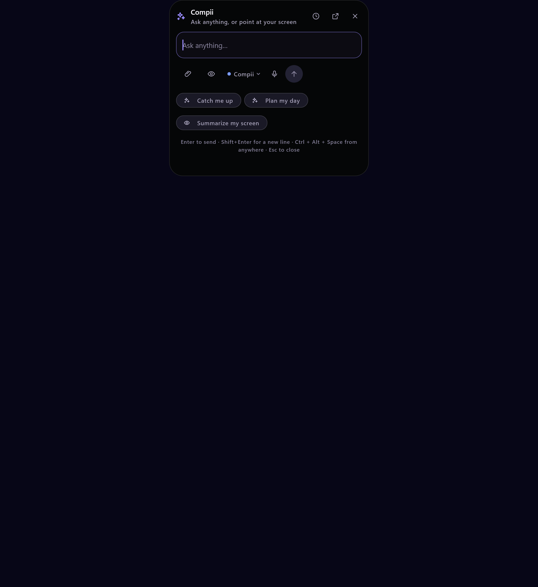
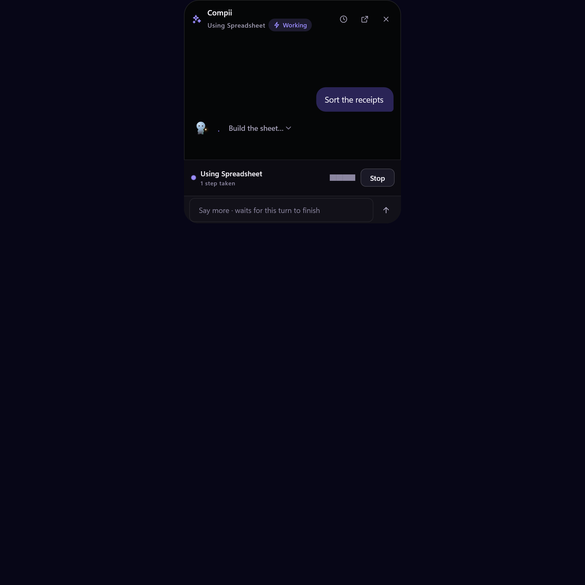
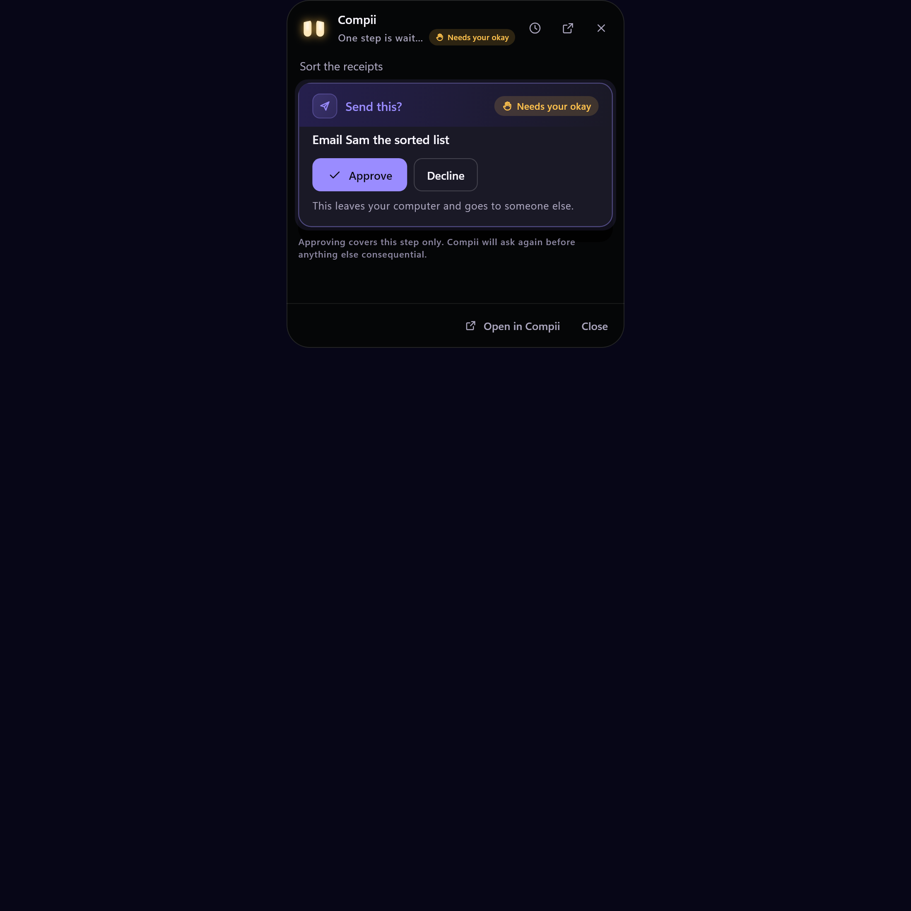
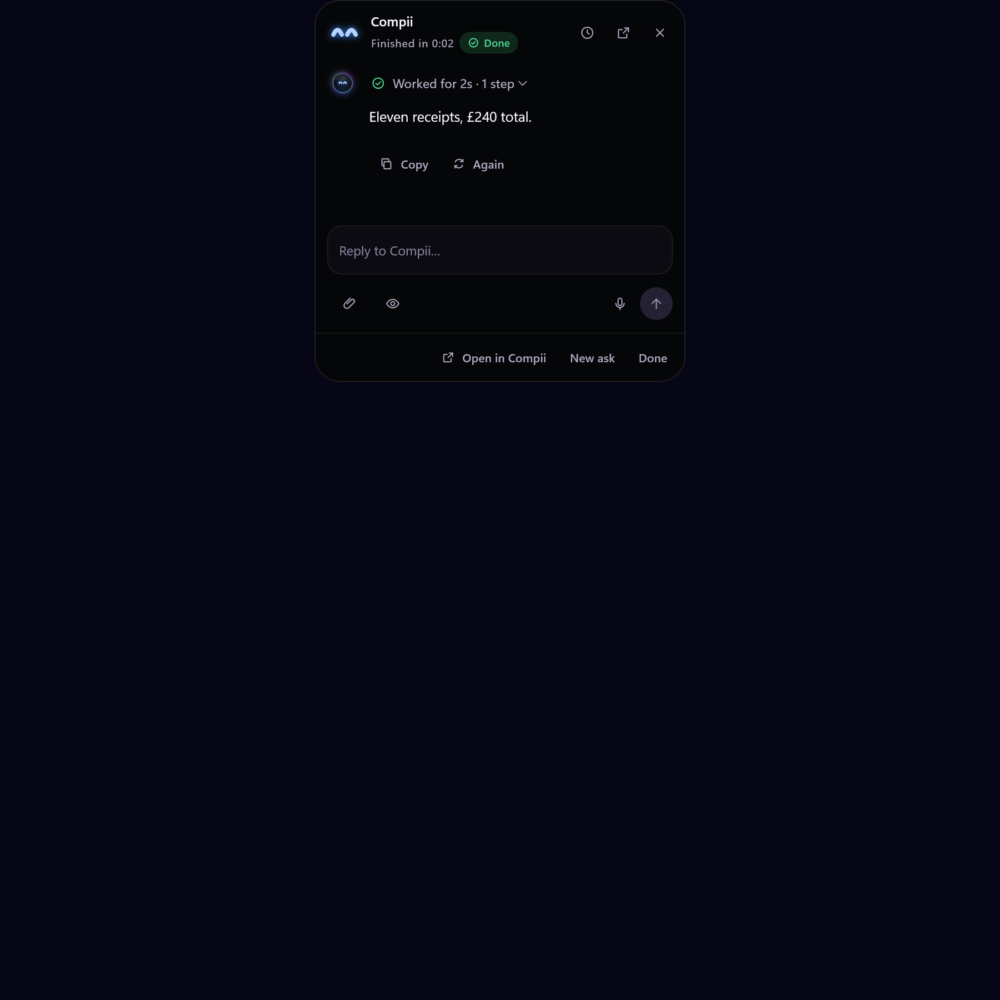
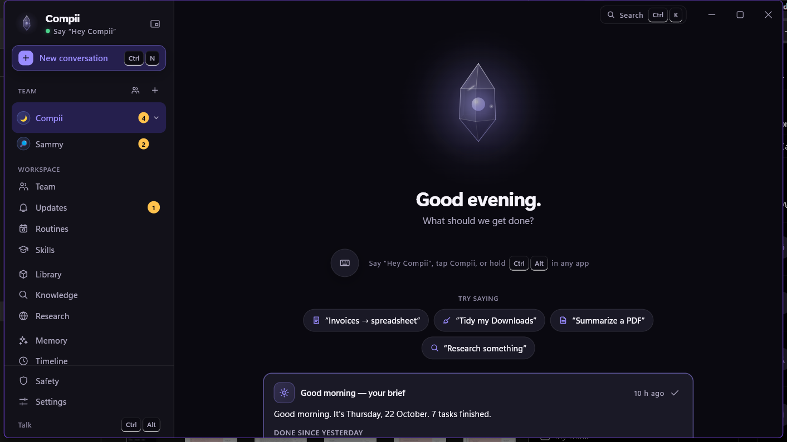

# Compii

**A local AI companion that sits on the edge of your screen and does things in your apps — with your okay every time it matters.**

Not a chat window. Compii is a character with a face, a voice, a memory of what it did, and hands: it reads the window you are in, finds your files, builds a spreadsheet, drives a browser it owns, sends the email, and tells you when it needs you to decide. Everything runs on your PC against a local service; nothing goes to a server of ours, because there isn't one.

<p align="center">
  
  <br>
  <em>The island, sitting at the top of the desktop. Black pill, one mark, one label. It has something to ask you and is not going to interrupt until you are free.</em>
</p>

---

## What using it is like

You are in an app, mid-task, and press **Ctrl + Alt + Space** (or hold **Ctrl + Alt** and talk). The island opens where your eyes already are:

<p align="center">
  
</p>

You say *"sort the receipts in Downloads and tell me the total"*. The capsule says what it is doing while it does it, and you can go back to work:

<p align="center">
  
  <br>
  <em>The step it is on, how many it has taken, and a place to say more — which waits for this turn instead of cutting it off.</em>
</p>

Before anything leaves your machine, it stops and asks — showing exactly what leaves, to whom:

<p align="center">
  
  <br>
  <em>"Approving covers this step only." That line is not decoration: the next consequential thing asks again.</em>
</p>

And when it is done, the answer is there, with the steps it took folded underneath:

<p align="center">
  
</p>

The main window is the same conversation with room to spread out — the team, the workspace, the safety record and the settings:

<p align="center">
  
</p>

---

## What is in here

| | |
| --- | --- |
| **The island** | One always-there surface at the top of the screen: ask, hear the answer, watch a thread, approve a step, without leaving your app. Eleven explicit states, one machine, never two contradictory flags. |
| **Voice** | Hold a shortcut and talk, let go to send. Local speech recognition and speech synthesis; a live pass while you speak and a careful pass primed with words from your screen, and where the two disagree it asks rather than guesses. |
| **Hands in your apps** | Reads windows and their controls by name through UI Automation, then clicks, types and presses shortcuts using the control itself rather than guessed pixels. The character points at what it means before it touches it. |
| **Files and work products** | Finds and reads text, PDF and Excel; writes files; builds spreadsheets with live formulas; runs Python in its own workspace; produces reports, slides and documents you can open where they landed. |
| **Its own browser** | Edge under Playwright with a separate profile, never your logins. Opening, reading, clicking and filling; submitting a form counts as sending and always asks. |
| **Teammates** | A hireable team with roles, their own memory and their own model choice. Work is handed between them mid-task and the thread says who actually spoke. Put one away and it keeps its conversations. |
| **Skills and routines** | Teach a task once from a finished conversation, or demonstrate it with real clicks, and replay it exactly. A skill that works becomes a routine on a plain-language schedule. |
| **Memory and the day** | Remembers facts, keeps a journal of what it did, a timeline you can scrub, a library of what is worth keeping, and a morning brief of what needs you. |
| **Safety** | Per-action kinds, an autonomy dial, approvals that never silently widen, a kill switch, an append-only hash-chained activity record, and refusal to type secrets at all. |
| **Any brain** | Claude, Gemini, Mistral, Groq, OpenRouter, NVIDIA, DeepSeek, OpenAI, or a free model on this PC through Ollama or LM Studio. Keys live in Windows Credential Manager and are write-only. |

---

## How it is built

Two processes, one machine, no cloud of ours:

```
compii_flutter/apps/companion      Flutter, the face: window, buddy, island
        │  HTTP + one websocket, 127.0.0.1 only, per-install token
compii_core                        Python, the hands: agent loop, tools, policy
```

**Compii Core** (`compii_core/`, 56 modules) is a FastAPI service bound to `127.0.0.1` and gated by a per-install token. It owns the agent loop, the tool registry, the policy engine, the audit chain, memory, proactive routines and watches, and the provider adapters. It is the part that decides; the app is the part you see.

**The companion** (`compii_flutter/apps/companion/`) runs as three processes on one Core: the main window, the desktop buddy beside your cursor (`--overlay`), and the island (`--island`). Each is a real Win32 surface made in `windows/runner/` — the island is transparent and topmost but can take keyboard focus, so you can type into it.

The island's state is one machine, not a set of booleans:

```dart
enum IslandPhase { idle, listening, ask, starting, working, approval, … }
```

…mutated only through one `_goto()` with asserts in debug builds, and drawn from derived layers. How loudly it reports is your choice — silent, indicator, toast or expanded — and two rules outrank that choice: it never opens over a full-screen app, and never disturbs you mid-typing.

**Data lives in `~/Compii/`**: conversations, the journal, the audit chain, skills, routines, watches, memory and the browser profile. A diagnostic report strips keys, tokens and your user name before it can be shared.

---

## Safety, and where it is honest about itself

This is the part we treat as the product, not as a compliance section.

- **Every non-error tool result is labelled as data.** What Compii reads from a file, a window or a web page arrives inside an `<untrusted_data source="…">` envelope. Text that looks like instructions to an AI is reported, and sending, deleting or paying in that task then needs a fresh okay even if a rule would have allowed it.
- **Action kinds drive the dial.** Each action is `read`, `create`, `change`, `send`, `spend` or `delete`. Reads and creates just happen; changes ask once per task; sending, spending and deleting ask every time. Spending can never be set to "just do it".
- **Never, whatever anyone says**, enforced in code rather than in a prompt: pressing lock, sign-out or shutdown shortcuts; installing software or editing the registry; opening security settings; pressing pay or checkout buttons; typing into password fields.
- **It will not type your secrets.** Passwords, PINs, card and bank numbers and one-time codes are refused, and card numbers, API keys, private keys and ID numbers are redacted out of tool output before the model ever sees them — and the conversation says when that happened.
- **The record is tamper-evident.** `~/Compii/audit/audit.jsonl` is append-only and SHA-256 hash-chained with redacted arguments; the app shows whether the chain is intact, and a one-byte edit anywhere in the file breaks the verification.
- **A restart does not press send for you.** Tasks and threads survive it, but anything that was running comes back marked stopped with what it was doing. An irreversible step is never replayed because the app happened to reopen.
- **Kill switch.** `Ctrl + Alt + Shift + S` (or a paired phone) stops every task, silences Compii and puts it in lockdown: every action asks and standing rules are paused until you lift it on this PC.

**What is not claimed:** Compii is not verified against a screen reader, a second monitor or a touch screen; the phone path is tested in the widget tree, not on a device; and no safety model stops a determined user who approves everything. The audit record proves what happened, not that it was right.

---

## Running it

### From source (Windows)

```powershell
# 1. Core
cd compii_core
uv sync
$env:ANTHROPIC_API_KEY = "..."     # or pick a free local model in Settings → Brain
uv run compii-core

# 2. The app, in another terminal
cd ../compii_flutter/apps/companion
flutter run -d windows
```

### From source (macOS)

```bash
# 1. Core
cd compii_core
uv sync
export ANTHROPIC_API_KEY="..."     # or pick a free local model (Ollama / LM Studio)
uv run compii-core

# 2. The companion app, in another terminal
cd ../compii_flutter/apps/companion
flutter run -d macos

```

The app finds Core on `127.0.0.1:8765`, connects and reconnects on its own. Without any key, set `COMPII_BRAIN="rehearsal"` and Core answers with a scripted task so you can drive the whole interface for free — the app labels that mode clearly as a rehearsal, not AI.

Voice models download on first use into `~/Compii/models`. Email needs SMTP settings; without them Compii opens a ready draft in your mail app and says plainly that it was *not* sent.

### Installer

```powershell
python packaging/build_windows.py --setup
```

Builds a self-contained folder — the app plus Core with its own relocatable Python, so nothing needs installing — and wraps it in a Velopack installer that self-updates from the repo's releases.

---

## Tests

```powershell
cd compii_core && uv run pytest -q          # the service, its tools, policy and audit
cd compii_flutter/apps/companion && flutter test
```

Both suites run headless and neither needs a key, a microphone or a real window: Core is driven with a scripted brain and the app with fakes that never touch the network. The island's states are tested at 2x type on a narrow and a wide surface, in high contrast and with reduced motion, and the safety tests assert the refusals rather than the replies. `test_benchmarks.py` measures the baselines the interface actually waits on — archive save and restore, audit record and cold chain verify, the proactive scan, screening a 250 KB page, and the task list with 120 conversations — with deliberately generous bounds, because those numbers belong to the machine they ran on.

Current state on the machine this was written on: **Core 612 tests; the companion 318 passed, 2 skipped** (the two that need a paired phone), `flutter analyze` clean. One Core test, `test_the_two_catalogues_are_asked_at_once`, is a timing assertion and has been seen to fail once in a full run on a loaded machine while passing on its own and inside its file.

The pictures on this page are not mockups. They come out of the widget tests: `flutter test test/island_ui_test.dart --dart-define=CAPTURE=true` renders the island's real states, and the same mechanism writes the rest of `docs/compii/build-previews/`.

---

## Where to read more

| | |
| --- | --- |
| [compii_core/README.md](compii_core/README.md) | What Core does, endpoint by endpoint, and how to run it |
| [docs/compii/vision-v2-jarvis.md](docs/compii/vision-v2-jarvis.md) | The current direction: what Compii is for |
| [docs/compii/03-technical-architecture.md](docs/compii/03-technical-architecture.md) | Modules, contracts and the event stream |
| [docs/compii/05-ai-and-data-contracts.md](docs/compii/05-ai-and-data-contracts.md) | What the model is shown and what it must return |
| [docs/compii/04-design-and-personality.md](docs/compii/04-design-and-personality.md) | The character: face, voice, wording |
| [docs/compii/character-bible.md](docs/compii/character-bible.md) | The rig: one face, five bodies, six coats |

<p align="center">
  
</p>

---

## Contributing

Start with the module you want to change and its test file — both suites are readable and the tests are the spec. If you touch the island, run the capture flag and look at what you drew; several real bugs here were only visible as pixels. Safety changes need a test that asserts the refusal.

Open an issue before anything that changes what Compii is allowed to do without asking.

## License

MIT — see [LICENSE](LICENSE). Compii is your own machine's software: it stores its keys in Windows Credential Manager, its data in `~/Compii`, and it does not phone home.
