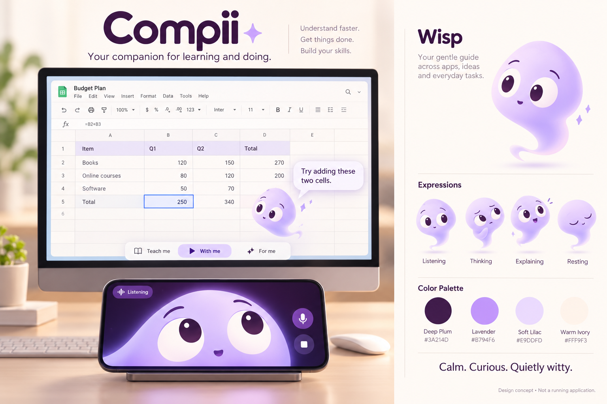

# Compii — Design & Personality

Version 1.0 · 15 October 2026 · Wisp direction selected by user

## Visual reference and authority

The supplied/created image establishes the visual direction and default phone presentation. It is concept art, not a running application. This written specification controls exact interaction, scale and accessibility: the concept's desktop Wisp is oversized for illustration, and incidental spreadsheet content is not a functional specification.

## Identity

Name: Compii. Character: Wisp. Brand promise: your companion for learning and doing. Tagline: Learn it. Do it. Together.

Wisp is an organic lilac spirit with a rounded upper body and curved tapered tail. Large white eyes, dark plum pupils, subtle brows and a small expressive mouth provide readability. No robot shell, faceplate, antenna, mechanical joints or metal. Avoid fur and photoreal materials; use a clean shape-and-gradient treatment reproducible in Flutter. Small side wisps may express gestures without becoming mechanical limbs.

The two dots in the final `ii` may evoke eyes in a wordmark exploration. Keep the product name readable. Do not copy Bluey's blueberry silhouette or another product's mascot. Reuse behavioral ideas from the reference, not its brand identity.

## Phone presentations — explicit user decision

Exactly two top-level options:

1. **Face View — default.** Large eyes and cropped Wisp face fill the phone, matching the reference. Landscape hero view with gaze coordinated to desktop activity; adapt safely to portrait.
2. **Full-body View — optional.** Show the complete floating spirit on the phone. Within this option, choose Float (gentle movement) or Rest (stationary position). Movement occurs inside Compii, not above other apps.

Persist choice per device. First launch always starts in Face View unless restoring a user's stored choice. The alternate view is not a second character, second AI identity or separate conversation. User can switch instantly without interrupting audio/task state. Motion intensity and reduced motion are separate settings. Keep microphone, stop, connection state and listening indicator visible in both views.

## Desktop presentation

Small full-body Wisp, 48–72 logical pixels by default, adjustable for accessibility. Dock at screen edge while idle; approach a target when explaining. Place bubbles outside target bounds and keep them within the display safe area. Do not cover text the user needs. Provide Hide companion and keyboard access to all features. Resting, floating and pointer behaviors should not imply continuous capture.

Quick panel: text/voice, mode selector, capture indicator and stop. Expanded workspace: lessons, tasks, research, memories, devices and settings. Use plain labels: Teach me / With me / For me. Each mode has a textual state; color alone is insufficient.

## Tokens — implementation baseline

| Token | Value | Use |
|---|---|---|
| Ink / Deep Plum | `#3A214D` | Primary text, pupils, dark phone backdrop |
| Lavender | `#B794F6` | Character shading and decorative emphasis |
| Soft Lilac | `#E9DDFD` | Selected surfaces and subtle highlights |
| Warm Ivory | `#FFF9F3` | Main light background |
| White | `#FFFFFF` | Eyes and elevated light surfaces |
| Muted Ink | `#66566F` | Secondary text, subject to contrast verification |
| Strong Accent | `#6C3BA8` | Filled action buttons with white labels |

Do not use light lavender as small text on ivory. Measure actual contrast: 4.5:1 normal text, 3:1 large text and essential control boundaries. Baseline spacing: 4/8/12/16/24/32. Corner radii: 12 controls, 20 panels; avoid making every surface a pill. Use a readable system sans-serif initially. Choose and verify licenses before bundling fonts.

Touch targets at least 48 logical pixels; keyboard focus always visible. Support text scaling, screen-reader labels, captions, high contrast and reduced motion. Effects must not flash. Meet contrast with tokens and widget tests, not visual appearance alone.

## Expression and motion states

| State | Face | Motion / status |
|---|---|---|
| Idle | Relaxed open eyes | Gentle slow bob, or still with reduced motion |
| Listening | Attentive widened eyes | Small lean; explicit Listening indicator |
| Thinking | Thoughtful gaze and brow | Restrained pulse; no endless unlabelled animation |
| Explaining | Engaged expression | Gaze toward target, speech/caption synchronization |
| Acting | Focused eyes | Visible task status; pointer movement only for authorized step |
| Waiting | Patient neutral face | Approval/question shown clearly |
| Success | Brief pleased expression | Small celebration, no repetitive reward loop |
| Error | Concerned but calm | Explain issue and next option |
| Resting | Closed/soft eyes | Stillness; microphone off unless separately indicated |
| Disconnected | Neutral | Connection label; never masquerade as active listening |

Timing targets: 150–250 ms control transitions, 250–450 ms expression changes; ambient movement slow and limited. Reduced motion removes drift and decorative particles. Avoid celebratory audio by default.

## Personality contract

Calm, curious, quietly witty. Compii is an AI companion and does not claim human feelings or consciousness. Humor is occasional and never at the user's expense. Respectful correction beats flattery. Do not invent observations, completed actions or memories. Express uncertainty clearly.

Teaching: one meaningful step at a time; explain why; offer hints, worked examples or a deeper explanation. Execution: concise milestones and concrete results. Research: separate evidence from inference and link claims. Errors: explain what failed without blaming the user. Users can adjust verbosity, humor, language and voice without changing permission boundaries.

Sample lines:

- “Try selecting those two cells. I'll check the result.”
- “That worked. Now try the next row yourself.”
- “The draft is ready. Review the recipient before I send it.”
- “I found conflicting figures. Here's what each source says.”
- “The page changed. I'll locate the control again.”

## Asset provenance

`assets/compii-wisp-concept.png` was created using the built-in image-generation tool, guided by the user's Bluey screenshot. Prompt brief: original organic lilac Wisp with large white eyes, small desktop companion and speech bubble, large-face landscape phone, ivory/plum/lavender palette, no robotic elements. This is a direction reference; production paths, expression parameters and exact sizes still need implementation and review. The concept does not illustrate the alternative Full-body phone view, which is explicitly required above.
