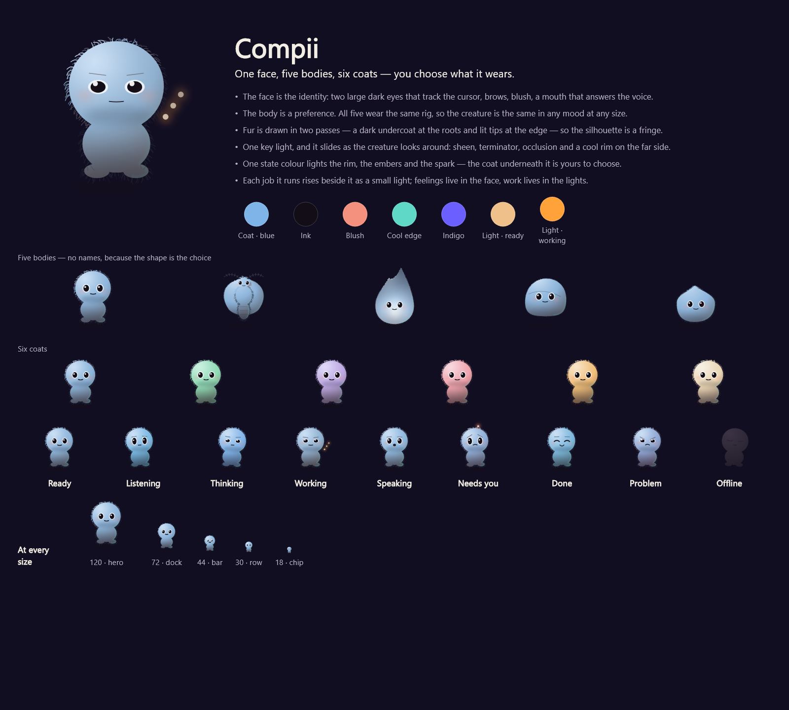
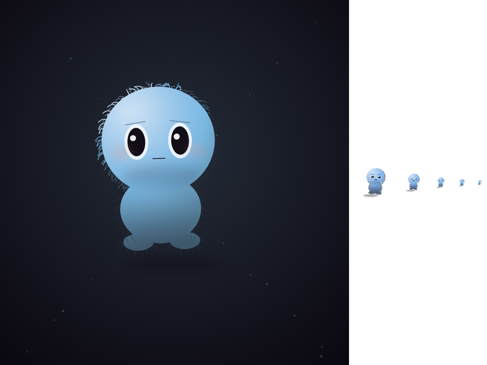
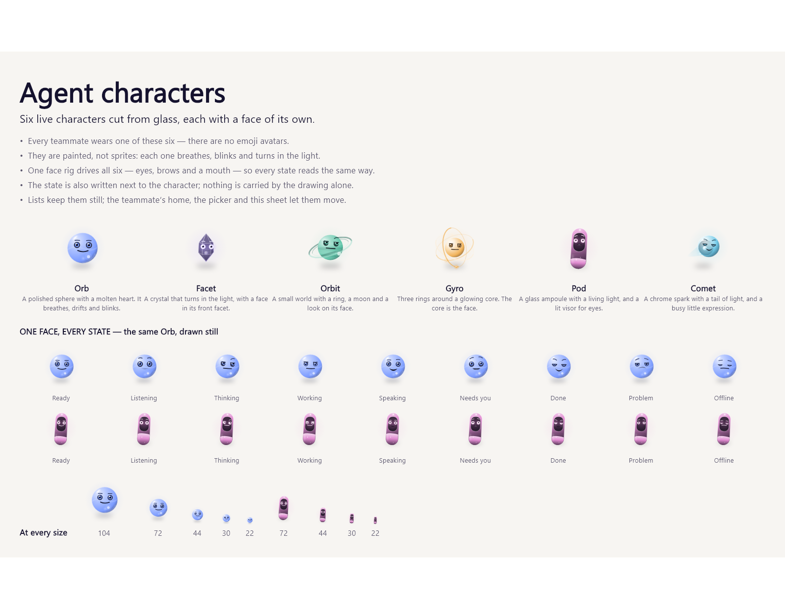
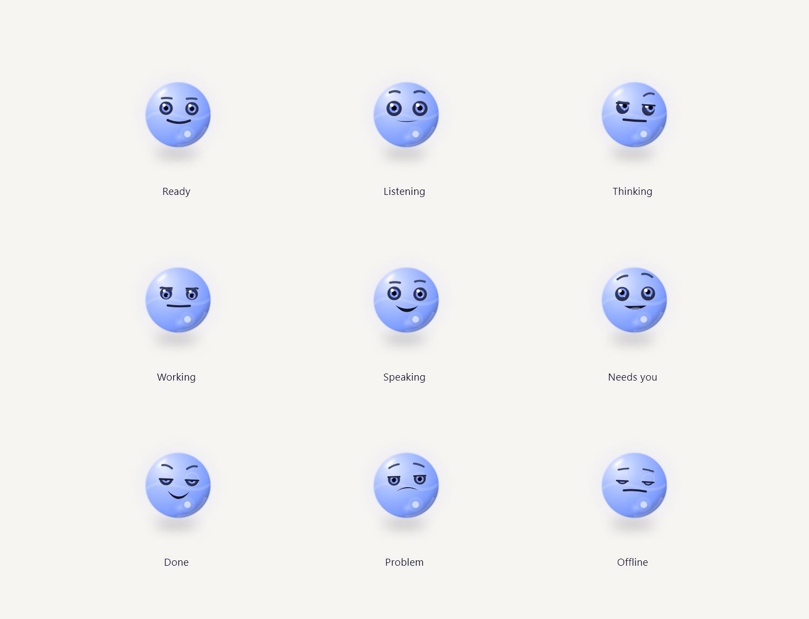

# Compii — Character Bible

Version 5 · 23 October 2026

Replaces v4 (same creature, but cream, and its five bodies carried names nobody needed on screen), v3 (the hearth-moth — rejected: it was geometrically a butterfly, and a butterfly was never the brief), v2 (the Lumen — rejected: a stone has no face to look back at you) and v1 (the Orbling).

**v3 is withdrawn for two reasons.** First, the drawing: wings spread flat and mirrored either side of a thin body, with a division between fore and hind lobe and a round eyespot mid-wing, is a butterfly. Calling it a moth in the document did not change what was on screen. Second, the citations: v3 attributed "Ropet" and "Linky" to Grok and cited a "Microsoft Mico". Neither checks out, and this document is only worth having if the sources are real. Everything below is either read from a named source or marked as our own reasoning.









## Who Compii is

Compii is **one small creature with a face**, wearing a body and a coat colour you choose. The default is the round one: a big blue head, a small soft body, two stubby feet, two large dark eyes that track the cursor, brows, a blush, and a mouth that answers the voice. Nothing about the silhouette names a species, so nothing about it can be drawn wrong.

The face is the identity. The body and the coat are preferences. That split is the whole design decision, and it is the shape Meta shipped Muse in.

The bodies are **not named**. v4 called them Pip, Mica, Ember, Pebble and Dew; the picker showed the name under a 64 px drawing, and the name did nothing that the drawing did not already do better. What is left is five shapes and six colours, side by side, and the descriptions survive only as screen-reader text.

The teammates are hard, cool, volumetric objects — glass, crystal, chrome. Compii is the one warm, soft, matte thing on the screen.

Personality: calm, curious, quietly witty, very capable. It does the work and tells you plainly what happened.

## The rule the whole design follows

**Feelings live in the face. Work lives in the lights. Facts live in the words.**

- The rig carries nine moods through brows, eye opening, eye shape, mouth and stance. That is all it is allowed to carry.
- One small light per running job rises beside the body. That number is the real number of tasks; it is never decoration.
- Anything else — what Compii is doing, what it found, what it needs from you — is text next to the character. It is never a code to be decoded from a shape.

v3 broke this rule by asking wings, antennae and eyespots to signal state simultaneously. That is why it needed a bible to explain itself. A design that needs a legend has already failed at the size a companion is actually seen.

## Where the idea comes from

| Source | What it actually says | What we kept |
|---|---|---|
| **Meta, "Introducing Muse", about.fb.com, 8 Sep 2026** | A personal agent that keeps working after you close the app and "comes back when something changes or when it needs approval"; it shows "a complete audit trail of everything it has done and plans to do"; talking to it works like messaging a person. | The loop the character sits in: work in the background, return, ask before the irreversible thing, show the trail. Compii's `Needs you` and `Done` states exist because the product loop does. |
| **NBC News on Muse's default avatar, 24 Sep 2026** | The default Muse avatar is "cream-colored and has beady black eyes and an upward smile", is named "Jolly", and has a "completely customizable character and personality". Agents "can take on a variety of appearances, with users able to customize everything from their names to their attire"; Zuckerberg's own agent wears a toga and a wreath. | Beady dark eyes and an upward smile — that is the default body. And the architecture: one agent, many selectable appearances, customisation as a first-class feature rather than a skin. We took the *range* of customisation and left the cream behind: the coat is a choice, so the default is ours. |
| **NBC News, "Tech companies are making their robots cute to win over humans", 22 Feb 2026** | Ellie Sanoubari (human–robot interaction researcher): expect "larger heads, big eyes and the ability to make 'cute' noises — all of which can evoke deeply seated biological responses in us". DoorDash built its robot Dot round "because studies have shown that humans tend to prefer rounded elements over boxy, square ones"; Dot has "big, circular eyes", "looks in the direction that it plans to steer" and makes eye contact to signal intent. | Big head, big round eyes, all-round geometry. And the most useful line in the whole set: **the eyes show what the machine is about to do.** Compii's pupils track the cursor and its gaze leads its reach. |
| **xAI's Grok companions** | Grok shipped named companions — Ani, Rudy (and Bad Rudy), Valentine, and later Mika — each with its own face and voice. Access to the original set has since changed, so this is cited as a product pattern, not as a live reference. | A companion can have a *character* rather than a theme. We took that as far as it goes and stopped: each of Grok's names belongs to a different face and voice, while our five bodies share one face and one voice, so a name on a body would promise a personality it does not have. |
| **Our own reasoning, not a source** | Three dark marks in a downward triangle — two eyes and a nose or mouth — fire the face-recognition system regardless of how little else is there. A silhouette that only reads if you already know the animal has nowhere to go at 38 px. | Two large eyes plus a mouth, and a body shape that never has to be recognised to be likeable. The eyes are the last thing to be dropped at small sizes. |

## The rig

One table in `character.dart` maps mood → expression, and all five bodies read it. `brow` lifts both ends, `tilt` lifts the inner end (positive is the worried brow; negative aims it at the nose), `eye` is shut → wide, and `mouth` runs frown → smile with values above 1.5 meaning "open, sized by the voice".

The numbers are set bigger than they look on paper, because half of these characters are seen at 30–44 px in a row or a sidebar, where a brow that moves one pixel is not a brow at all. Every mood is checked against the sheet at all five sizes, not just at hero.

| Mood | Label | Light | Expression | Extra |
|---|---|---|---|---|
| Ready | `Ready` | `#EFC08A` | level brows, full eyes, a small upturn | the only face drawn without brows |
| Listening | `Listening` | `#5FE0D2` | brows up, eyes wide to 1.3, mouth quiet | leans toward the sound |
| Thinking | `Thinking` | `#8FC4FF` | eyes down to .56, one brow up, mouth flat | leans in on itself |
| Working | `Working` | `#FFA23A` | narrowed to .62 and aimed, calm mouth | one light per running task |
| Speaking | `Speaking` | `#FFE2A8` | mouth open, sized by the microphone level | — |
| Needs you | `Needs you` | `#FF8A6B` | brows up and pulled together, mouth turned down | a pulsing light above the head |
| Done | `Done` | `#7FE8A8` | lids shut into upward arcs, big smile, eyes closed | a seven-ray burst once |
| Problem | `Problem` | `#FF5A52` | brows down and in, mouth down | nothing else moves |
| Offline | `Offline` | `#7E7570` | eyes shut, mouth slack | grey, no glow, no blink |

Colour is never the only signal: brows, eye shape, mouth and stance change with it, and the text label stays on screen beside the character.

## The bodies

All five wear the identical rig and the identical coat. Only the silhouette and its own motion differ. Chosen in Settings → Appearance, and kept on this PC in `SharedPreferences` (`compii_form`, `compii_coat`) — they are taste, not state the machine needs to know about.

| Key | Form | Its own motion |
|---|---|---|
| `plush` | Big round head, small soft body, two stubby feet. No ears, no wings, no shell — nothing that can be the wrong species. | Hops on the beat, drifts wide. The default. |
| `moth` | Wings **tented over the back like a roof**, a thorax fatter than anything else on it, a segmented abdomen, combed antennae swept back, and the face on the head. | Hovers: twice the beat, a short drift, the roof flexing. |
| `spark` | A small flame, licking to one side, with a hot core. The one body whose material *is* light rather than fur. | Gutters: three times the beat, the tip licking, the core breathing. |
| `shell` | A river stone: wider than tall, a settled base, one seam. The quietest of the five. | Settles: less than half the bob of the others. That is the point. |
| `drop` | A plump drop, wider than tall, short-necked. | Wobbles off-beat — twice the rate, a wide sway, and it squashes as it settles. |

**Why the moth is not a butterfly.** v3's moth failed on four specific geometry tells, and each is now closed: the wings are one tented roof rather than two flat panels held out sideways; there is no parting between a fore and a hind lobe, because there is only one wing shape per side; the thorax is the fattest thing about the creature instead of a thread; the antennae are combed (a feather of short teeth off a curved shaft), not a wire with a club on the end; and there is no eyespot painted mid-wing — the face is on the head, where an animal's face is. The four vein pairs were also dropped: at sheet size they read as a ladder painted on the wing, so the wing carries one soft centre crease instead.

## The coat

Six brushed-in colours, each a swatch in the same picker, each shown as it actually renders — a light-to-dark chip, not a flat dot:

| Key | Hex | | Key | Hex |
|---|---|---|---|---|
| `blue` | `#7FB4E8` | ← default | `rose` | `#F2A2B4` |
| `mint` | `#83E0BC` | | `amber` | `#F5C179` |
| `lilac` | `#B7A6F2` | | `cream` | `#EEDDBE` |

The coat is the *material*; the state colour only tints it (`_Coat.of` mixes 13% of the mood into the base and pulls the shade toward ash). That keeps six coats from becoming six moods — change the coat and Compii is still `Working` or `Needs you` in the same way.

The flame is the exception that had to be handled on purpose. It is drawn from the state colour, so a coat picker would have done nothing at all on the body the user happens to have chosen. Now the coat owns the crown and the burn just under it (`_Coat.flame` takes the chosen hue), and only the foot of the flame belongs to the state — so a blue coat is a blue-white flame over a cool burn, and the mood still reads through the value range, which is how a flame is read at all.

## Palette

| Name | Hex | Use |
|---|---|---|
| Coat | six, above | The body material. Identity — never a mood colour. |
| Ash and deep | `#241D2A` `#120D16` | The eyes, the undercoat roots, silhouettes, the shadow on the floor |
| Room | `#1C1322` | The dark the creature is actually seen in |
| Cool edge | `#5FD8C8` | The rim light on the side facing away from the key, so a warm coat never turns to jam |
| Blush | `#F4907E` | Cheeks. Deliberately outside the mood colours so a blush is never a state. |
| Indigo frame | `#6B5FFF` | Focus rings, overlay border, selection — the product's, not the creature's |
| Light / gold | `#FFF0D8` `#FFC86B` | The catch of light in the eye, the job lights |
| State colour | `EmberPalette.core(mood)` | The glow, the embers, the job lights, and 13% of the coat |

## The material

Two things make the bodies read as objects in a room rather than stickers: a coat of hair, and one light that moves.

**Fur.** Each body is brushed in two passes — a dark undercoat starting *inside* the outline, then lit tips starting *on* it — so the silhouette itself is a fringe rather than a hard edge with hairs drawn on top of it. Every hair is one quadratic curve: it leaves the outline along the local normal, and its tip falls toward gravity and scatters sideways, so the coat lies instead of standing out like a sea urchin. The sway of the whole coat is the body moving underneath it. Hairs are batched into five tone paths by how far they sit from the key light, so a coat costs five `drawPath` calls a frame, not two hundred. Their lengths and bends come from a pure integer hash of their index, so the coat is different on every hair but identical on every frame — a coat that boils is the fastest way to make procedural art look cheap.

**One key light.** A single light sits up-left in figure space and **slides as Compii looks around**, so turning toward something visibly moves the light across the body. From it comes a four-stop skin ramp, a sheen under the light, an occlusion pool at the bottom, a cool rim on the far edge, and a cast shadow that offsets opposite the light. The terminator stops short of black on purpose: a body that reaches black at the edge reads as a hole in the picture, not as a round thing.

At chip size (level 0, under 30 px) the fur is not drawn at all — two hundred hairs on an 18 px body is grey mud, and there the gradient alone carries the idea of a coat.

## Behaviour rules

1. **The face is always there.** Every body wears the rig at every size. A Compii you cannot make eye contact with is not Compii.
2. **Idle is calm, and it is not a loop.** The breath is a regular eight-second cycle; the blink is not on it. Blinking sits on a second, deliberately incommensurate 37-second cycle at six uneven gaps, the last two a pair — the double blink people actually do when they are tired or thinking. A creature that blinks on the beat is a GIF, and each body drifts, hops and rocks on its own tempo so five bodies are not one body drawn five ways.
3. **It speaks only when there is news** (done, problem) **or a question** (needs you).
4. **It looks at the cursor only when it is free to attend.** While working, its place is fixed and it does not chase the pointer.
5. **The reach points at the thing being discussed** and never covers text the user needs.
6. **Job lights always match the real number of running tasks.** Never decorative, never rounded up.
7. **Long answers leave the creature's area entirely** and open in a readable panel away from it.
8. **Detail scales down, it does not blur.** Level 2 (≥ 64 px) has brows, blush, comb teeth and a full two-pass coat. Level 1 (≥ 30 px) keeps the eyes, the catch of light and the mouth but drops the brows and the cheeks, because at that size they read as dirt, and brushes a shorter, sparser coat. Level 0 (the chip) is two eyes and the silhouette with no hair at all — the gradient carries the coat there, and the eyes are the last thing to go.
9. **Reduced motion freezes everything** — bob, beat, lick, blink, embers, rays — and every mood stays readable through brow, eye shape, mouth and colour.

## Teammates

Every teammate is one of six volumetric characters, chosen per bot, drawn in code with real volume, shading and perspective — not sprites, never an emoji.

| Design | Form |
|---|---|
| **Orb** | A polished sphere with a molten heart; it breathes, drifts and blinks. |
| **Facet** | A crystal turning in the light, with a face in its front facet. |
| **Orbit** | A small world with a ring, a moon and a look on its face. |
| **Gyro** | Three rings around a glowing core; the core is the face. |
| **Pod** | A glass ampoule with a living light and a lit visor for eyes. |
| **Comet** | A chrome spark with a tail of light and a busy little expression. |

Lists keep them still for calm reading; the teammate's home, the picker and the team view let them move. Saved as one token per bot: `a1.<shape>.<seed>`. A missing or unusable token falls back to a design hashed from the name, so a teammate looks the same every time even before anyone has chosen one.

## Implementation

Main character: `compii_flutter/apps/companion/lib/src/console/character.dart`.

- `CompiiBody { plush, moth, spark, shell, drop }` and `CompiiCoat { blue, mint, lilac, rose, amber, cream }`. Each carries a `desc` and nothing else user-facing — no labels, because the drawing is the choice. `compiiBody` and `compiiCoat` are global `ValueNotifier`s that `Ember` listens to, so picking either in Settings redraws every instance at once.
- `_Rig` is the mood → expression table; `_Rig.mix(previous, mood, blend)` eases between states over 420 ms.
- `_Coat` is one material: `hue` (what was picked), `tip`, `lit`, `base`, `shade`, `dark`. `_Coat.of` builds it from the chosen coat plus a touch of the state; `_Coat.flame` builds the light-body version, where the coat keeps the crown and the whole shaded side and only `dark` — the burn under it, which is what the occlusion and the undercoat are brushed with — belongs to the state. Tinting the flame's mid ramp with the state instead turns a blue coat to grey mud on the body most people wear.
- `_Figure` is the creature. It draws one body (`_plush`, `_moth`, `_spark`, `_shell`, `_drop`) and then `_face`, which is shared. Figure units: the body fits inside roughly −0.5…0.5 on both axes. `_Fit` gives each body the anchor and scale where *its* face goes, which is why one set of face numbers fits a wide moth head and a narrow flame.
- Its life is three numbers off two clocks: `tempo` (a per-body record of rate, sway and hop), `sway`/`seat` (the drift and the bob), and `rock`, a few degrees pivoted at `y = .42` so a lean tips the body as a weight instead of sliding it. `_blinks` is the list of uneven gap positions on the slow clock, and `_EmberState.drift` is the 37-second controller that `s` reads from — deliberately not a multiple of the 8-second `clock`, so the two never line up.
- `_furred` is the single material entry point every body calls: fill, then `_volume`, then `_hairs`. `_blob` unions a body's lobes first, so no hair is drawn on a seam inside the creature.
- `EmberPainter` (the whole creature) and `EmberFacePainter` (the phone's close-up, with the room and the dust) each only set up a transform and hand it to `_Figure`. The dock chip and the full-screen presence view are the same artwork.
- `_radial` anchors every gradient to the shape's real bounds and computes the radius from the farthest corner, because Flutter measures a `RadialGradient` radius against the rect's *shortest* side — otherwise a wide body never gets past its first colour stop and reads as a flat band.
- `_px(n)` floors every stroke at one device pixel so a hairline stays a hairline at 18 px, and `_noise(int)` is the deterministic hash behind every hair.
- The global `pointer` notifier feeds the look, and the look feeds `key` — the light slides with the eyes.

Persistence: `ShellState.load()` reads `compii_form` and `compii_coat` and `setBody`/`setCoat` write them; an unknown stored name falls back to the default instead of throwing. `SettingsPage` → Appearance renders each body wearing its real face and each coat as the gradient it actually paints.

Shared 3D mesh (teammates): `compii_flutter/apps/companion/lib/src/art/gem_mesh.dart`. Teammates: `compii_flutter/apps/companion/lib/src/ui/agent_character.dart` (`AgentFace`, `AgentLook`, `AgentShape`, `showAgentPicker`) and `bots.dart` (`BotAvatar`).

Render the sheets with:

```bash
flutter test test/character_capture_test.dart test/agent_character_capture_test.dart --dart-define=CAPTURE=true
```

### Phone Presence View (built)

On phones the screen is the creature's room: a dark field warmed by whatever it is doing, dust rising, the figure at about two-fifths width with its job lights, and the floating controls over it. Status, speech, approvals, the command box, mic and Stop float in front; tasks open in a sheet. Tap the face to talk; tap again to send, or to interrupt it.

### Desktop pointing overlay (working)

- **Works:** Core's `point_at` tool finds a button or menu by its visible label through Windows UI Automation and sends a `point` event; the overlay draws the creature beside the item with a thread of light reaching out, an indigo ring around the item and a bubble.
- **Window:** the overlay is a small borderless, always-on-top popup that never takes focus. It shows on the real desktop with transparency around the character, and clicks pass through it. Flutter draws through DirectComposition, which shows nothing in a window that is already layered when its surface is created. So the runner makes the popup layered and click-through (`WS_EX_LAYERED | WS_EX_TRANSPARENT`, alpha 255) only after the first frame is on screen (`Win32Window::Show`). The app starts the overlay automatically on Windows.

## Sources

- Meta Newsroom — [Introducing Muse: The World's First Personal AI Agent Built for Everyone](https://about.fb.com/news/2026/09/introducing-muse-personal-ai-agent/) (8 Sep 2026)
- NBC News — [It's cute. It's cuddly. And it wants your data.](https://www.nbcnews.com/tech/tech-news/meta-muse-ai-agent-response-animated-avatar-cute-rcna599736) (24 Sep 2026)
- NBC News — [Tech companies are making their robots cute to try to win over humans](https://www.nbcnews.com/tech/tech-news/tech-companies-cute-robot-designs-win-over-humans-rcna259818) (22 Feb 2026)
- Layer3 — [Grok Companions Explained: Ani, Rudy, Valentine](https://www.layer3labs.io/guides/grok-companions-explained) (26 Aug 2026)
